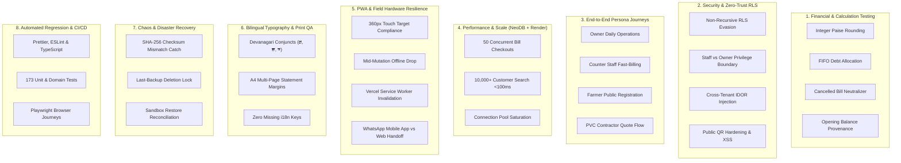

# Overall Application Testing Strategy & Quality Assurance Architecture
**Rushi CRM Platform v2.0 (Dual-Business Cattle Feed & PVC Irrigation)**
**Target Infrastructure:** Frontend on **Vercel** | Database on **NeoDB / Postgres** | Backend Services on **Render**

---

## 1. Executive QA Philosophy: Beyond Unit & Integration Testing

In enterprise dual-business financial platforms, traditional unit and integration tests only verify that individual functions and database queries execute without syntactical errors. They **fail to catch the most dangerous production failures**:
- Multi-line rounding discrepancies accumulating across hundreds of invoices.
- Race conditions during peak morning hours colliding on transactional bill numbers.
- Horizontal privilege leaks where counter staff inspect owner profit margins.
- Offline network drops causing duplicate customer debt entries.
- Marathi Devanagari font corruption on physical A4 laser printers.
- Cross-tenant data leaks across isolated business entities.

This testing architecture establishes an **end-to-end, multi-layered quality assurance framework** designed for real-world field conditions across desktop and Android mobile devices.

---

## 2. Risk-Based Testing Matrix

| Risk Dimension | Probability | Impact | Critical Failure Mode | Testing Strategy & Guardrail |
| :--- | :---: | :---: | :--- | :--- |
| **Financial Ledger Integrity** | Medium | Critical | Floating-point rounding error, double-applied payments | Integer paise accounting, atomic transactional RPCs, balance reconciliation scripts |
| **Multi-Tenancy Isolation** | Low | Critical | Staff accessing owner profits or Cross-tenant IDOR | Non-recursive PostgreSQL RLS audit, automated authorization matrix tests |
| **Concurrency Collisions** | High | High | Two staff creating Bill #1042 simultaneously | PostgreSQL row-level locks in `create_bill_transactional`, unique bill index |
| **Field Network Interruption** | High | High | Farmer payment recorded twice due to flaky 4G connection | Client-side idempotency keys, sticky offline banners, transactional rollback |
| **Devanagari PDF Corruption** | Medium | Medium | Marathi conjunct consonants printing as gibberish boxes | Embedded licensed Unicode fonts, headless PDF canvas snapshot tests |
| **Disaster Recovery Failure** | Low | Critical | Backup corrupted or last backup accidentally purged | SHA-256 checksum verification, `enforce_backup_retention` security gate |

---

## 3. The 8 Testing Pillars of the Overall Application



---

## 4. Detailed Test Specifications by Pillar

### Pillar 1: Financial & Calculation Correctness (Pure Integer Paise)
1. **Multi-Item Floating-Point Boundary Test:**
   - *Scenario:* Create a bill with 7 line items having fractional paise rates (e.g., 18.5% GST on PVC fittings with quantity 33).
   - *Pass Criteria:* All calculations operate on integer paise (`Math.round` applied at atomic line total). Total bill amount strictly equals the sum of line items. No fractional paise ever sent to the database.
2. **Oldest-Debt FIFO Allocation Test:**
   - *Scenario:* Customer has 3 outstanding bills: Bill A (₹500), Bill B (₹300), Bill C (₹200). A partial payment of ₹650 is received.
   - *Pass Criteria:* Bill A is marked `paid` (₹500 paid, ₹0 balance), Bill B is marked `partial` (₹150 paid, ₹150 balance), Bill C remains `unpaid` (₹0 paid, ₹200 balance). Total customer outstanding decreases by exactly ₹650.
3. **Advance Overpayment Test:**
   - *Scenario:* Customer with ₹500 outstanding pays ₹800.
   - *Pass Criteria:* Bill marked `paid`. Excess ₹300 recorded as unallocated customer advance credit, visible on Khate Utara.
4. **Retroactive Bill Cancellation Test:**
   - *Scenario:* Cancel Bill #108 after 3 weeks.
   - *Pass Criteria:* Bill status updated to `cancelled`, original bill number preserved in history, ledger balancing entry posted, customer outstanding immediately reduced. Dashboard sales exclude cancelled amounts, but audit log preserves the original creation and cancellation details.

---

### Pillar 2: Security, Penetration & Zero-Trust Multi-Tenancy
1. **Non-Recursive RLS Evasion:**
   - *Scenario:* Inject unauthorized `business_id` in Supabase query headers or client mutation payloads.
   - *Pass Criteria:* Database RLS automatically discards user-supplied `business_id` and derives tenant access solely from authenticated `auth.uid()` via `memberships` table. Unauthorized rows return 0 records or throw PostgreSQL permission denied.
2. **Staff Privilege Boundary Penetration:**
   - *Scenario:* Authenticate as a user with `role = 'staff'` and attempt to query:
     - `/api/profitability` (Profit metrics)
     - `public.suppliers` and `public.purchase_orders` (Cost prices)
     - `public.audit_events` (Staff activity tracking)
     - `public.backup_artifacts` (Database export)
   - *Pass Criteria:* All queries rejected by RLS. UI navigation excludes private links; direct URL navigation redirects to authorized dashboard.
3. **Public QR Registration Hardening:**
   - *Scenario:* Submit `/qr-register` form with SQL injection vectors (`' OR 1=1 --`), XSS payloads (`<script>alert(1)</script>`), and extreme character lengths (10,000 characters).
   - *Pass Criteria:* Zod schema rejects malformed inputs. Phone numbers normalized to standard 10-digit format. No sensitive internal database schema or customer records leaked in response.

---

### Pillar 3: End-to-End Persona Journeys (Playwright & Manual)
1. **Persona A: Business Owner Morning Governance:**
   - Log in -> Switch between Cattle Feed & PVC businesses -> View Daily Financial Summary -> Review Overdue Reminders -> Click "Prepare WhatsApp" -> Inspect prefilled message in review modal -> Record "Owner Marked Sent" -> Verify status moves to `owner_marked_sent` without false delivery claims.
2. **Persona B: Counter Staff Peak-Hour Billing:**
   - Search customer by mobile number -> Auto-populate customer profile -> Add 3 Cattle Feed products -> Toggle cash payment received -> Click "Confirm & Print Bill" -> Modal displays printable Marathi invoice -> Save committed in <1.5s -> Customer ledger immediately reflects new balance.
3. **Persona C: Agricultural PVC Contractor Quote Request:**
   - Open public PVC Catalogue -> Search "6kg 75mm PVC Pipe" -> Click "Ask for Quote" -> Deep-links to WhatsApp with pre-formatted product specifications -> WhatsApp message opened on user's device.

---

### Pillar 4: Concurrency, Performance & Scale (NeoDB + Render)
1. **High-Concurrency Bill Generation (Race Condition Defense):**
   - *Scenario:* 50 simulated concurrent bill checkout requests submitted simultaneously on the same business.
   - *Pass Criteria:* Database transactional lock in `create_bill_transactional` guarantees:
     - 0 duplicate bill numbers.
     - 0 gaps in sequential bill numbering for the financial year.
     - Exactly 50 distinct bills committed without deadlocks.
2. **Large-Dataset Search Performance:**
   - *Scenario:* Database seeded with 10,000 synthetic customers and 50,000 bills.
   - *Pass Criteria:* Customer search by phone prefix or Marathi name completes and updates UI in <100ms using debounced index queries.

---

### Pillar 5: PWA, Mobile & Offline Resilience
1. **360px Viewport Hardware Test:**
   - *Scenario:* Load entire application on 360px viewport (Android budget phone standard).
   - *Pass Criteria:* Zero horizontal scrollbar. Bottom navigation is sticky. All touch targets (buttons, inputs, select items) have minimum 44px x 44px clickable bounding box.
2. **Network Interruption During Bill Creation:**
   - *Scenario:* Disconnect internet connection immediately after clicking "Confirm Bill".
   - *Pass Criteria:* Application displays sticky `OfflineBanner`. Form does not silently discard data. Submit button disables to prevent double-billing. When connection restores, user is prompted to retry with idempotent token.
3. **Vercel Deployment Cache Invalidation:**
   - *Scenario:* Vercel deploys a new commit while user has PWA open.
   - *Pass Criteria:* Service worker detects new build, prompts user "New version available — Click to update", and clears stale cached bundles without corrupting active local storage.

---

### Pillar 6: Bilingual Typography & Physical Print Acceptance
1. **Marathi Devanagari Print Fidelity:**
   - *Scenario:* Generate and print Customer Khate Utara with complex Marathi farmer names (e.g., "ज्ञानेश्वर", "लक्ष्मण", "कृष्णा") and addresses.
   - *Pass Criteria:* Printed physical A4 or high-resolution PDF snapshot displays crisp conjunct consonants with zero box substitutions ("tofu" glyphs).
2. **Multi-Page Statement Formatting:**
   - *Scenario:* Customer statement spanning 45 transaction rows across 3 pages.
   - *Pass Criteria:* Table headers repeat on pages 2 and 3. Page numbers format as "पृष्ठ २ / ३". Summary balance due and signature block appear strictly at the bottom of the final page without overlapping rows.

---

### Pillar 7: Chaos Engineering & Disaster Recovery
1. **SHA-256 Checksum Tamper Test:**
   - *Scenario:* Download a database backup artifact, modify a single byte, and attempt a sandbox restore.
   - *Pass Criteria:* Restore engine detects SHA-256 checksum mismatch and aborts execution before touching any database tables.
2. **Last-Backup Deletion Lock:**
   - *Scenario:* Attempt to delete the sole remaining verified backup point in the system.
   - *Pass Criteria:* PostgreSQL stored procedure `enforce_backup_retention` raises an exception: *"Cannot delete the last remaining verified recovery point."*

---

## 5. QA Execution Cadence & Gate Matrix

```
[Developer Working Copy]
       │
       ▼
[Gate 1: Pre-Commit Validation] ➔ npm run format:check && npm run lint && npm run typecheck
       │
       ▼
[Gate 2: Automated Unit & Domain Suite] ➔ npm run test:unit (173 / 173 tests)
       │
       ▼
[Gate 3: Browser Acceptance E2E] ➔ npx playwright test (Desktop Chrome + Mobile Android)
       │
       ▼
[Gate 4: Staging Deployment Smoke Test] ➔ Vercel Preview + NeoDB Staging Instance
       │  • Verify RLS boundaries with Owner and Staff synthetic accounts
       │  • Generate sample bilingual A4 statement PDF
       │  • Verify WhatsApp deep link opens with prefilled text
       │
       ▼
[Gate 5: Production Go-Live Sign-Off] ➔ Verified Backup Point + Owner Sign-Off
```

---

## 6. Defect Severity & Triage SLA

| Severity | Definition | Target Resolution SLA | Release Blocking? |
| :--- | :--- | :---: | :---: |
| **S1 — Blocker** | Financial miscalculation, RLS tenant leak, bill number collision, data loss | Immediate (<4 hours) | **YES (Hard Stop)** |
| **S2 — Critical** | WhatsApp handoff fails, PDF font corrupted, backup restore fails, offline crash | <24 hours | **YES (Hard Stop)** |
| **S3 — Major** | Non-financial UI glitch, search pagination slow (>1s), translation missing fallback | <48 hours | No (If workaround exists) |
| **S4 — Minor** | Spacing inconsistency, minor copy tweak, non-critical animation hitch | Next sprint | No |

